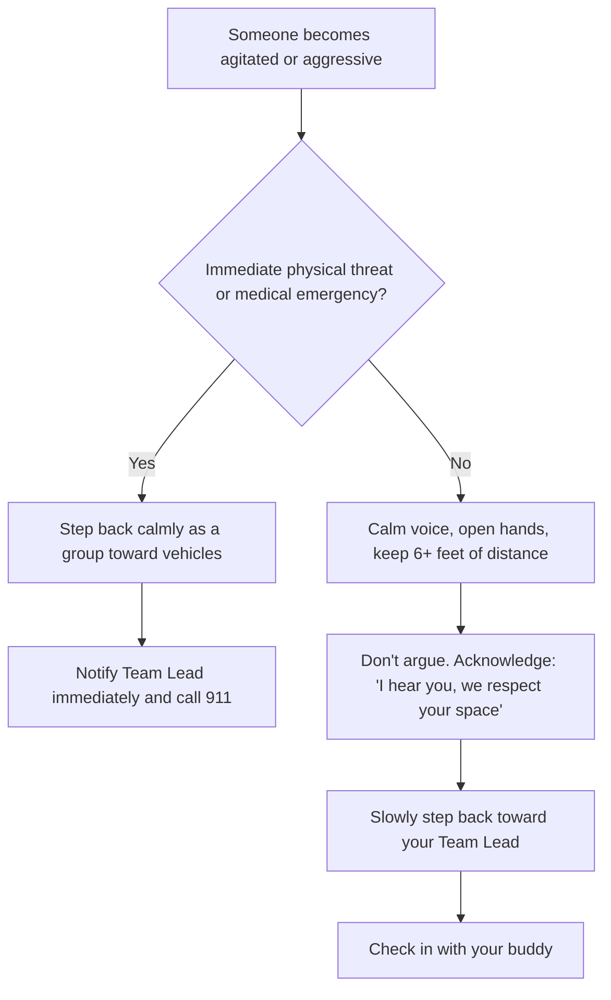

# Volunteer Orientation & Safety Briefing

> *"Whatever you did for one of the least of these brothers and sisters of mine, you did for me."*
> — **Matthew 25:40**

Thank you for your heart to serve our unhoused neighbors. Entering spaces where vulnerable people live requires humility, compassion, situational awareness, and clear adherence to safety protocols.

---

## Christlike Posture & Dignity

- ✅ **Presence Over Transaction**: Treat every person as a neighbor, not a project. Ask their name, listen attentively, and honor their story. Sit or kneel at eye level rather than towering over someone seated on a curb or sleeping pad.

- ✅ **Unconditional Service**: Help is never contingent on listening to a sermon or accepting prayer. Offer prayer warmly, but accept a "no" with grace.

- ✅ **Preserve Agency & Choice**: Allow individuals to choose meal options, clothing sizes, or items. Avoid assuming what someone needs.

- ✅ **Respect Privacy**: Never take photos, record video, or post stories on social media without explicit permission.

- ✅ **Announce Yourself**: Tents, cars, and makeshift shelters are homes. Knock gently on a car window or call out from 6–8 feet away from a tent door:
    > *"Good morning! Resonate Church Street Ministry here with hot breakfast and fresh water. Are you open for visitors today?"*

    If someone declines or asks you to leave, honor their boundary:
    > *"No problem at all, friend! We have water and food kits here if you want any later. Have a blessed morning."*

---

## Personal Safety & Boundaries

- ✅ **Buddy System (Strict)**: Always operate in teams of two or more. Never enter tents, isolated alleyways, or vehicles alone.

- ✅ **Personal Privacy**: Do not share personal phone numbers, home addresses, or financial details. Provide the church or ministry contact.

- ✅ **Transportation Policy**: Volunteers are strictly discouraged from giving personal rides in private vehicles.

- ✅ **Possessions**: Keep personal bags and valuables locked in your vehicle trunk out of sight before arriving on-site.

- ✅ **No Cash**: Never hand out cash from your wallet. For urgent fuel, transit, or medicine needs, consult your Team Lead, who carries pre-approved Clipper cards, gas cards, and emergency resources.

### What to Wear & Bring

| Item | Recommendation | Note |
|:-----|:---------------|:-----|
| **Footwear** | Closed-toe sturdy boots or sneakers | Broken glass, uneven creek terrain, and wet brush are common. |
| **Clothing** | Modest, weather-layered, durable jeans/pants | Avoid flashy logos, expensive jewelry, or excessive accessories. |
| **Hands-Free** | Small cross-body bag or backpack | Keep hands free to carry coffee carafes, meal bags, or hygiene boxes. |
| **Hydration** | Reusable water bottle | Stay hydrated during 2 to 3 hour walking routes. |
| **Gloves & Sanitizer** | Nitrile/utility gloves and hand sanitizer | Essential when handling food items or setting up tables. |

---

## Health & Logistics Standards

- ✅ **Food Handling**: Wear disposable gloves during all food handling. Keep hot foods above 140°F and cold items refrigerated until serving.

- ✅ **Hygiene Kits & Packs**: Distribute unopened toiletries and sealed non-perishables. Direct medical inquiries to local clinics.

- ✅ **Clean as We Go**: Leave every serving area cleaner than we found it. Carry extra heavy-duty trash bags.

---

## De-escalation & Incident Protocol

- ✅ **Recognizing Agitation**: If someone becomes agitated or aggressive, maintain a calm voice, keep 6+ feet of distance, and avoid arguing.

- ✅ **Graceful Exit**: Slowly step back toward your team lead. Prioritize personal and group safety over completing a task.

- ✅ **Emergency Escalation**: For acute medical emergencies or immediate physical threats, notify the team lead immediately and call 911.

### Emergency Contacts

* **Emergency:** 911
* **Team Lead (On Call):** Kent Mitchell, (510) 709-9338
* **Mobile Crisis Team (Alameda County):** 1-800-491-9099
* **Non-Emergency Dispatch:**
    * Fremont PD: (510) 790-6800
    * Hayward PD: (510) 293-7000
    * Newark PD: (510) 578-4237
    * Union City PD: (510) 471-1365

---

## Team Debrief & Closing Prayer

- ✅ **Prayer**: Gather immediately after outreach for a 10-minute debrief to process encounters and pray for individuals by name.
