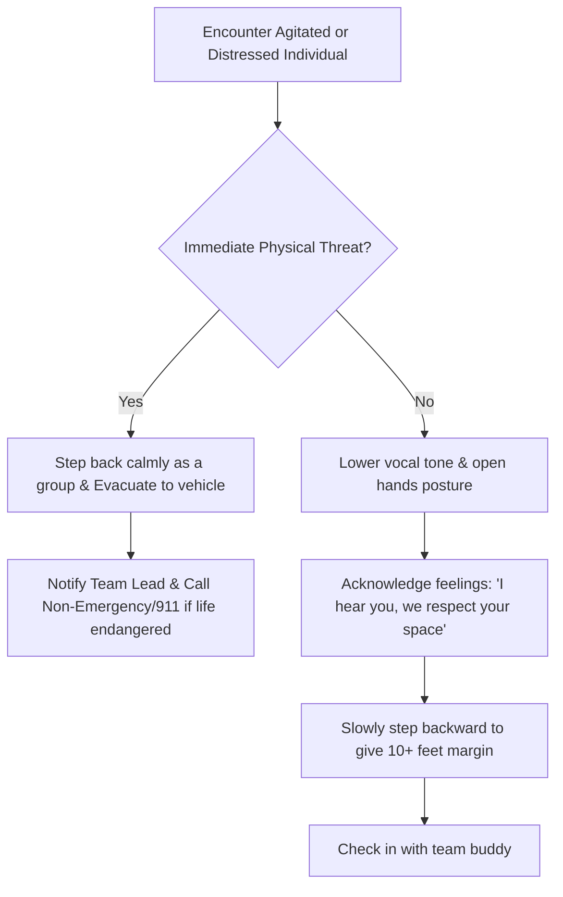

# Volunteer Guidelines & Street Etiquette

Thank you for your heart to serve our unhoused neighbors. Entering spaces where vulnerable people live requires humility, compassion, situational awareness, and clear adherence to safety protocols.

---

## 1. What to Wear & Bring

| Item | Recommendation | Note |
|:-----|:---------------|:-----|
| **Footwear** | Closed-toe sturdy boots or sneakers | Broken glass, uneven creek terrain, and wet brush are common. |
| **Clothing** | Modest, weather-layered, durable jeans/pants | Avoid flashy logos, expensive jewelry, or excessive accessories. |
| **Hands-Free** | Small cross-body bag or backpack | Keep hands free to carry coffee carafes, meal bags, or hygiene boxes. |
| **Hydration** | Reusable water bottle | Stay hydrated during 2 to 3 hour walking routes. |
| **Gloves & Sanitizer** | Nitrile/utility gloves and hand sanitizer | Essential when handling food items or setting up tables. |

---

## 2. The Golden Rules of Street Etiquette

### Announce Yourself Clearly
Tents, cars, and makeshift shelters are private residences. Knock gently on a car window or call out from 6–8 feet away from a tent zipper:
> *"Good morning! Resonate Church Street Ministry here with hot breakfast and fresh water. Are you open for visitors today?"*

If someone declines or asks you to leave, honor their boundary with respect:
> *"No problem at all, friend! We have water and food kits here if you want any later. Have a blessed morning."*

### Eye Contact & Active Listening
Sit or kneel at eye level rather than towering over someone seated on a curb or sleeping pad. Ask their name, listen to their answers, and speak to them as an equal neighbor.

### Never Give Cash Directly
To ensure transparency and volunteer safety, never hand out cash from your wallet. If an individual has an urgent need for fuel, bus transit, or medicine, consult your Team Lead who carries pre-approved Clipper cards, gas cards, and emergency resources.

---

## 3. De-Escalation & Safety Protocol

### Emergency Contacts
* **Team Lead (On Call):** (510) 555-0182
* **Mobile Crisis Team (Alameda County):** 1-800-491-9099
* **Non-Emergency Dispatch:**
  * Fremont PD: (510) 790-6800
  * Hayward PD: (510) 293-7000
  * Newark PD: (510) 578-4237
  * Union City PD: (510) 471-1365

